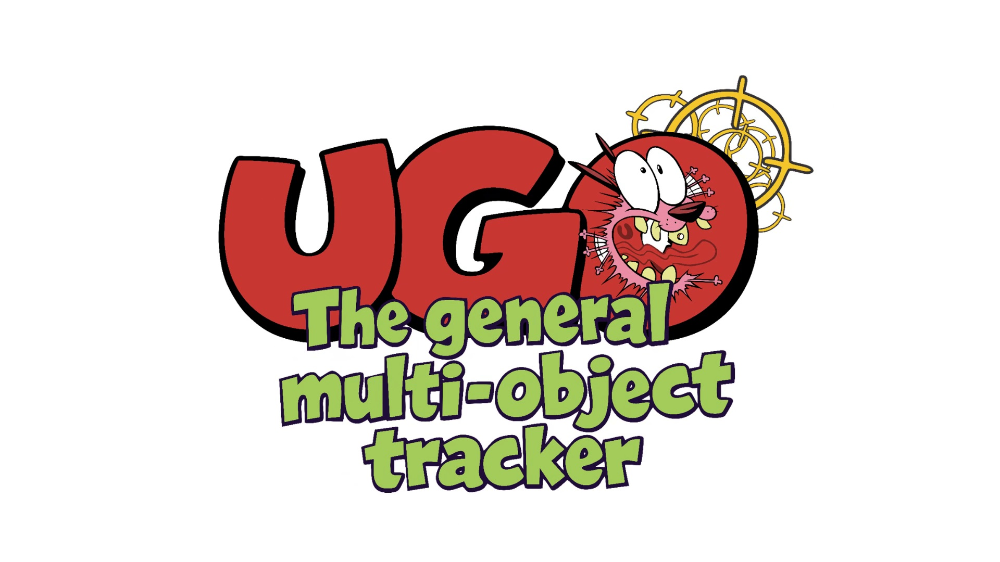
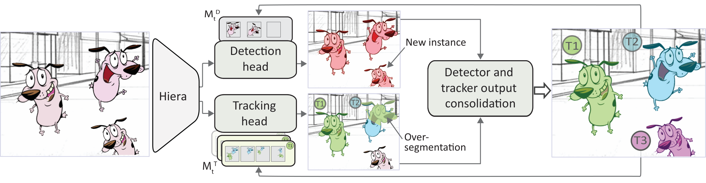

# UGO: Unified Architecture for General Multi-Object Tracking by Segmentation

**Accepted to NeurIPS 2026**

[https://github.com/jerpelhan/UGO](https://github.com/jerpelhan/UGO)

https://arxiv.org/pdf/2609.37339


<p align="center">
  
</p>


https://github.com/user-attachments/assets/e6891108-3ee1-4f28-8367-7a91f5b2c43e

## Highlights

- **Unified detection and tracking.** A shared Hiera backbone combines GECO2-based instance localization with SAM2 frame-to-frame propagation, producing compatible pixel-wise outputs from visual exemplars.
- **Training-free consolidation.** Energy minimization resolves overlaps, duplicates, and detector–tracker conflicts into mutually exclusive instance masks while suppressing poorly supported hypotheses.
- **Hierarchical adaptive memory.** Category-level memory adapts the detector's visual exemplars from reliable tracks, while recent-appearance and distractor-resolving memories improve instance segmentation and identity preservation.
- **Reliable track management.** Consolidated detections initialize tracks, corrected masks update their memories, and detector confirmation validates trajectories while collapsed tracks terminate cleanly.

## Architecture

<p align="center">
  
</p>


UGO is a training-free generic multi-object tracker using visual exemplars, GECO2-based detection, and SAM2.1 segmentation.

## Install

Requirements: Linux, Conda, an NVIDIA GPU with a CUDA 12.6-compatible driver, and a C/C++ compiler.

```bash
git clone --recurse-submodules https://github.com/jerpelhan/UGO.git
cd UGO
mkdir -p weights
```

Download the UGO checkpoint to `weights/UGO.pth`:

- [UGO.pth](https://drive.google.com/file/d/1dWYIIKzrOZB9Ouu_-jIql9FDIQ53MxY3/view?usp=drive_link)

```bash
bash scripts/install.sh
conda activate ugo
```

The installer creates the `ugo` Conda environment, builds the CUDA extensions, installs TrackEval, and downloads the SAM2.1 Hiera-L checkpoint.

## Datasets

Download the [GMOT40 images](https://github.com/Spritea/GMOT40/releases/download/v0.1/GenericMOT_JPEG_Sequence.zip) and [template boxes](https://github.com/Spritea/GMOT40/files/8863642/template_box_by_seq_for_global_track.zip), then extract both into the same directory.

```text
GMOT40/
├── GenericMOT_JPEG_Sequence/<sequence>/img1/*.jpg
└── template_box_by_seq_for_global_track/<sequence>.txt

AnimalTrack/
├── videos_test.txt
└── <sequence>/
    ├── img1/*.jpg
    └── gt/gt.txt

VideoCount/
├── Penguins/
└── Crystals/
```

Each VideoCount subset needs its annotation JSON, `frames/<video>/*.jpg`, and `exemplars/<video>/exemplars.json` with an exemplar image.

## Run

```bash
# GMOT40
python main_gmot.py \
  --data-root /path/to/GMOT40

# AnimalTrack
python main_animaltrack.py \
  --data-root /path/to/AnimalTrack

# ScienceCount
python main_sciencecount.py \
  --data-root /path/to/VideoCount \
  --subset all
```

All commands use `cuda:0` by default. Use `--device cuda:N` or `--sequence <name>` when needed. Existing result files are skipped, so interrupted runs can be resumed.

## Evaluate

TrackEval ground truth must contain `<benchmark>-train/` and `seqmaps/<benchmark>-train.txt`.

```bash
bash scripts/evaluate.sh GMOT /path/to/trackeval-gt

bash scripts/evaluate.sh AnimalTrack /path/to/trackeval-gt
```


## License

MIT. See `LICENSE`, note that we use thhird party libraries and models with their own licenses.
